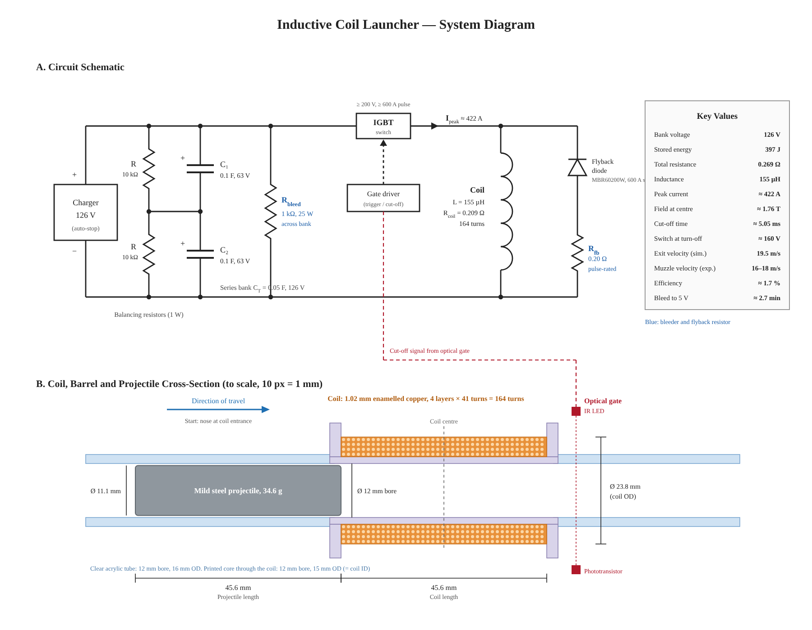

# Coilgun Circuitry

Electronics design for a coilgun (electromagnetic accelerator): a capacitor bank discharges into a multilayer coil to pull a soft-iron slug down a non-magnetic barrel. The first prototype is single stage; multi-stage is the goal.

## Status

Calculations for the single-stage design are final (updated 2026-11-10 for the ordered 12 mm ID tube and a 7/16 in slug). The source of truth is the team's Formulas_and_Theoretical_Framework doc on the shared drive; [docs/theoretical-framework.md](docs/theoretical-framework.md) mirrors it and a simulation script reproduces every number. Hardware is not built yet; open design issues are listed in the [design review](docs/design-review.md).

## Design at a glance

| | |
|---|---|
| Bank | 2 × 0.1 F, 63 V electrolytics in series: 0.05 F at 126 V, 397 J, 10 kΩ 1 W balancing resistor across each |
| Bleeder | 1 kΩ 25 W aluminium-housed across the bank: 15.9 W, 126 V to under 5 V in 2.7 min |
| Coil | 4 layers × 41 turns = 164 turns of 1.02 mm (18 AWG) enamelled copper, 45.6 mm long, 15.0 mm ID, 23.8 mm OD, 9.98 m of wire, on a printed PETG spool |
| Coil electrical | L = 155 µH (Wheeler), R_coil = 0.209 Ω, R_total = 0.269 Ω (overdamped) |
| Projectile | 7/16 in (11.1 mm) mild steel rod, 45.6 mm long, 34.6 g |
| Barrel | clear acrylic, 12 mm bore, 16 mm OD; through the coil, the printed spool core (12 mm bore, 1.5 mm wall) |
| Switch | IGBT / MOSFET, ≥ 200 V, ≥ 600 A pulse, turned off by an optical gate at the coil exit |
| Flyback path | SMC MBR60200W Schottky (200 V, 600 A surge) in series with 0.20 Ω pulse-rated wirewound, across the coil; switch sees 160 V at turn-off |
| Peak current | ≈ 422 A at 1.94 ms |
| Field at coil centre | ≈ 1.76 T |
| Cut-off | ≈ 5.05 ms, 348 A, bank left at 89.2 V |
| Muzzle velocity | 20.4 m/s at cut-off, 19.5 m/s (6.6 J) at coil exit simulated; 16–18 m/s expected after eddy, friction and back-EMF losses. The team chose the heavier slug for more energy over the 20 m/s target |
| Efficiency | 3.3 % of energy drawn, 1.7 % of energy stored (at exit) |
| Coil heating | ≤ 6.6 °C per shot |

## Repository layout

- `docs/theoretical-framework.md` all formulas and values, with figures
- `docs/design-review.md` open issues and numbers that changed from the earlier design
- `docs/figures/` system diagram and coil winding diagram (sources in `docs/figures/src/`)
- `model3d/` interactive 3D bench: [public link](https://claude.ai/artifact/MuPe8d1T68obQ319Ne9it8)
- `simulation/coilgun_model.py` hand calculations + circuit/projectile simulation (numpy only); see `simulation/README.md`
- `kicad/` KiCad projects (schematics and PCB layouts), not started

## Next steps

1. Simulate the discharge loop in KiCad / ngspice and compare against `coilgun_model.py`.
2. Design the low-voltage control board: microcontroller, IGBT gate driver, optical gate input.
3. Review with the team before ordering parts or boards.

## Safety

126 V is above the roughly 50 V DC level where skin stops limiting current to a safe level, and the bank stores about 400 J. Do not charge anything without a bleeder across the bank, a discharge stick, a meter reading under 5 V before hands go near it, and an experienced person supervising.
