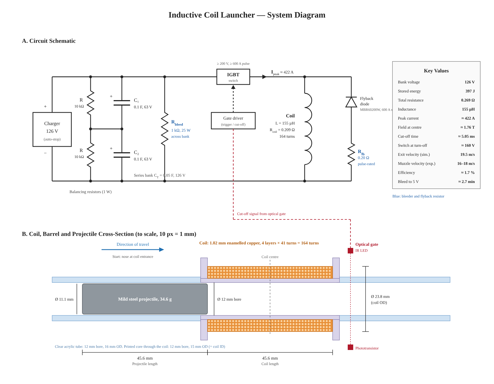
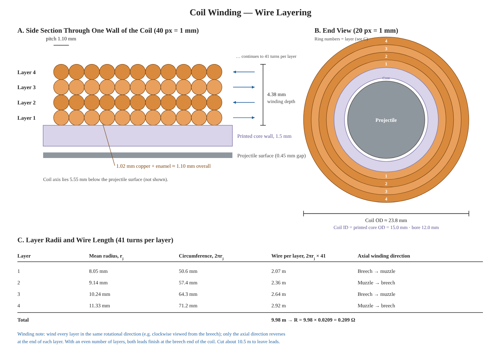

# Theoretical framework: inductive coil launcher

Single-stage design, final calculations. Source of truth: the team's **Formulas_and_Theoretical_Framework** doc on the shared drive; this file mirrors it. Updated 2026-11-10 for the ordered barrel tube (12 mm ID, 16 mm OD), a 7/16 in (11.1 mm) slug and a 1.5 mm printed core wall; the shared doc needs the same update. Every number below is reproduced by [`simulation/coilgun_model.py`](../simulation/coilgun_model.py).

## Design parameters

| Quantity | Symbol | Value |
|---|---|---|
| Capacitance (each, 2 in series) | $C$ | 0.1 F each → $C_T$ = 0.05 F |
| Charge voltage (capacitor rating) | $V_C$ | 63 V |
| Bank voltage (series) | $V$ | 126 V |
| Projectile mass | $m$ | 34.6 g |
| Projectile diameter | $d_p$ | 11.1 mm (7/16 in rod) |
| Projectile length | $l_p$ | 45.6 mm |
| Projectile material | | mild (low-carbon) steel |
| Target muzzle velocity | $v$ | 20 m/s |
| Coil length | $l$ | 45.6 mm |
| Coil inner radius | $r_i$ | 7.5 mm (printed core: 12.0 mm bore + 1.5 mm wall) |
| Coil mean radius | $a$ | 9.69 mm |
| Winding depth (4 layers) | $c$ | 4.38 mm |
| Wire diameter | $d_w$ | 1.02 mm (18 AWG) |
| Coil turns | $N$ | 164 |
| Coil resistance | $R_{coil}$ | 0.209 Ω |
| External resistance (ESR, switch, leads; estimated) | $R_{ext}$ | 0.060 Ω |
| Bleeder resistance (across bank) | $R_{bleed}$ | 1.0 kΩ, 25 W |
| Flyback resistance (in series with diode) | $R_{fb}$ | 0.20 Ω |
| Relative permeability (low-carbon steel) | $\mu_r$ | 500 |
| Saturation flux density (low-carbon steel) | $B_{sat}$ | 1.6 T |
| Permeability of free space | $\mu_0$ | 4π × 10⁻⁷ H/m |

## Capacitor bank

Energy per capacitor:

$$E_C = \tfrac{1}{2} C V_C^2 = \tfrac{1}{2}(0.1)(63)^2 = 198.5\ \text{J}$$

In series the voltages add and the capacitance halves:

$$V = 63 + 63 = 126\ \text{V} \qquad C_T = \frac{C_1 C_2}{C_1 + C_2} = \frac{(0.1)(0.1)}{0.2} = 0.05\ \text{F}$$

$$E_T = \tfrac{1}{2} C_T V^2 = \tfrac{1}{2}(0.05)(126)^2 = 397\ \text{J}$$

Same total energy as the parallel connection, delivered at twice the voltage.

**Balancing resistors.** A 10 kΩ, 1 W resistor across each capacitor keeps either one from exceeding 63 V:

$$I_{bal} = \frac{63}{10\,000} = 6.3\ \text{mA} \qquad P = \frac{63^2}{10\,000} = 0.40\ \text{W}$$

**Bank bleeder.** The balancing resistors alone drain the bank too slowly to count as a safety measure. In series they put 20 kΩ across the bank:

$$\tau_{bal} = (2R_{bal})C_T = (20\,000)(0.05) = 1000\ \text{s}$$

so 126 V takes about 54 minutes to fall below 5 V. A 1 kΩ, 25 W aluminium-housed bleeder across the whole bank fixes this:

$$I_{bleed} = \frac{V}{R_{bleed}} = \frac{126}{1000} = 0.126\ \text{A} \qquad P_{bleed} = \frac{V^2}{R_{bleed}} = \frac{126^2}{1000} = 15.9\ \text{W}$$

$$\tau_{bleed} = R_{bleed} C_T = (1000)(0.05) = 50\ \text{s} \qquad t_{5\,V} = \tau_{bleed}\ln\frac{V}{5} = 50\ln\frac{126}{5} = 161\ \text{s} \approx 2.7\ \text{min}$$

The 25 W rating holds only with the housing bolted to a heatsink, so it is mounted on an aluminium plate. During a 5 ms shot the bleeder draws 0.126 A against a 422 A peak, so it does not affect the launch; while charging, the charger supplies this 0.126 A continuously.

## Target

$$E_K = \tfrac{1}{2} m v^2 = \tfrac{1}{2}(0.0346)(20)^2 = 6.9\ \text{J} \qquad \eta = \frac{6.9}{397} = 1.7\ \%$$

## Projectile

Volume from mass (steel, ρ = 7850 kg/m³), length from an 11.1 mm diameter:

$$V_p = \frac{m}{\rho} = 4.41 \times 10^{-6}\ \text{m}^3 \qquad l_p = \frac{V_p}{\pi d_p^2/4} = 45.6\ \text{mm} \qquad \lambda = \frac{l_p}{d_p} = 4.1$$

**Effective permeability.** A short rod's own poles oppose the applied field. Demagnetising factor of a prolate ellipsoid with aspect ratio λ:

$$N_d = \frac{1}{\lambda^2 - 1}\left[\frac{\lambda}{\sqrt{\lambda^2 - 1}}\ln\left(\lambda + \sqrt{\lambda^2 - 1}\right) - 1\right] = 0.073$$

$$\mu_{eff} = \frac{\mu_r}{1 + N_d(\mu_r - 1)} = \frac{500}{1 + 0.073(499)} = 13.4$$

The slug saturates once the applied field reaches

$$B_s = \frac{B_{sat}}{\mu_{eff}} = \frac{1.6}{13.4} = 0.12\ \text{T}$$

The diameter is set by the barrel: the ordered tube has a 12 mm bore, and 7/16 in (11.1 mm) mild steel rod is a stock size that leaves a 0.45 mm gap per side. The length stays equal to the coil length, so the slug weighs 34.6 g, almost twice the earlier 8 mm, 18 g slug. The team chose this over the 8 mm slug knowingly: it leaves the coil about 2 m/s slower but carries about 45 % more kinetic energy (6.6 J against 4.5 J), because a wider slug fills more of the coil.

## Coil

**Turns.** Coil length over enamelled wire diameter (1.02 mm copper, about 1.10 mm with enamel):

$$N_{layer} = \frac{45.6}{1.10} = 41 \qquad N = 4 \times 41 = 164$$

**Wire length and resistance** (1.02 mm copper: 0.0209 Ω/m):

$$l_{wire} = \sum_{j=1}^{4} 2\pi r_j N_{layer} = 9.98\ \text{m} \qquad R_{coil} = (9.98)(0.0209) = 0.209\ \Omega$$

| Layer | Mean radius | Circumference | Wire (× 41) | Axial direction |
|---|---|---|---|---|
| 1 | 8.05 mm | 50.6 mm | 2.07 m | breech → muzzle |
| 2 | 9.14 mm | 57.4 mm | 2.36 m | muzzle → breech |
| 3 | 10.24 mm | 64.3 mm | 2.64 m | breech → muzzle |
| 4 | 11.33 mm | 71.2 mm | 2.92 m | muzzle → breech |
| **Total** | | | **9.98 m** | |

Wind every layer in the same rotational direction; only the axial direction reverses. With an even number of layers both leads finish at the breech end. Coil OD ≈ 23.8 mm, ID = printed core OD = 15.0 mm. Cut about 10.5 m of wire to leave leads.

**Why four layers.** Fewer layers raise the peak current (bigger switch) and lose speed; a fifth layer adds resistance and loses speed too.

| Layers (turns) | Peak current | Simulated exit velocity |
|---|---|---|
| 2 (82) | 764 A | 17.5 m/s |
| 3 (123) | 552 A | 19.2 m/s |
| **4 (164)** | **422 A** | **19.5 m/s** |
| 5 (205) | 336 A | 19.0 m/s |

**Inductance.** With l/a ≈ 4.7 and four layers the long-solenoid formula no longer holds. Wheeler's multilayer formula (a, l, c in metres, L in µH):

$$L = \frac{31.5\,a^2 N^2}{6a + 9l + 10c} = \frac{31.5(9.69\times10^{-3})^2(164)^2}{6(9.69\times10^{-3}) + 9(45.6\times10^{-3}) + 10(4.38\times10^{-3})} = \frac{79.6}{0.512} = 155\ \mu\text{H}$$

## Discharge (series RLC)

$$R = R_{coil} + R_{ext} = 0.209 + 0.060 = 0.269\ \Omega$$

$$R_{critical} = 2\sqrt{\frac{L}{C_T}} = 2\sqrt{\frac{155\times10^{-6}}{0.05}} = 0.111\ \Omega$$

R > R_critical, so the circuit is overdamped: the current rises and decays without oscillating.

$$\tau_L = \frac{L}{R} = 0.58\ \text{ms} \qquad \tau_C = R C_T = 13\ \text{ms}$$

**Peak current.** Resistive limit $I_{max} = V/R = 126/0.269 = 469$ A. Because τ_L is not negligible against τ_C, the bank voltage drops while the current is still rising:

$$I_{peak} \approx 422\ \text{A} \quad (t = 1.94\ \text{ms})$$

**Field at coil centre.** Long-solenoid estimate:

$$B = \mu_0 \frac{N I}{l} = (4\pi\times10^{-7})\frac{(164)(422)}{45.6\times10^{-3}} = 1.91\ \text{T}$$

Summing the field of every loop of the finite multilayer coil gives B_centre ≈ 1.76 T, and 3.71 × 10⁻³ T/A averaged over the slug. Both are far above B_s = 0.12 T, so the slug is fully saturated.

## Work and muzzle velocity

A ferromagnetic slug is pulled toward the region of highest inductance:

$$F = \tfrac{1}{2} I^2 \frac{dL}{dx} \qquad W = \tfrac{1}{2} I^2 \Delta L, \quad \Delta L = L_{with\ slug} - L_{air}$$

This replaces the earlier "number of coils" step, which set the coil's stored energy ½LI² equal to E_K. That is not the transfer mechanism: the bank keeps supplying current while the slug moves, and the work depends on how much the slug changes the inductance.

With the slug saturated, magnetisation is capped at M_s:

$$M_s = \frac{B_{sat}}{\mu_0} = 1.27\times10^6\ \text{A/m} \qquad W \approx V_p M_s\left(\bar{B} - \tfrac{1}{2}B_s\right)$$

Using an average current over the stroke of about 380 A:

$$\bar{B} = (3.71\times10^{-3})(380) = 1.41\ \text{T}$$

$$W = (4.41\times10^{-6})(1.27\times10^{6})(1.41 - 0.06) = 7.6\ \text{J}$$

$$v = \sqrt{\frac{2W}{m}} = \sqrt{\frac{2(7.6)}{0.0346}} = 21.0\ \text{m/s}$$

A time-domain simulation of circuit and projectile together gives **20.4 m/s (7.20 J)** at cut-off. It leaves out eddy currents, friction and back-EMF, which typically cost 15–30 % of the kinetic energy, so the expected muzzle velocity is **16–18 m/s** (from the 19.5 m/s exit velocity below).

## Current cut-off

Coil length equals slug length, so the slug centre reaches the coil centre as its nose reaches the coil exit. An optical gate at the coil exit turns the switch off there (simulated t_cut ≈ 5.05 ms). Without the cut-off, τ_C = 13 ms outlasts the stroke and the slug is pulled back to about 8.2 m/s.

The energy left in the coil is absorbed by the flyback diode and the 0.20 Ω flyback resistor across the coil:

$$E_L = \tfrac{1}{2} L I_{cut}^2 = \tfrac{1}{2}(155\times10^{-6})(348)^2 = 9.4\ \text{J}$$

**Flyback resistor.** With the diode alone, the coil current decays slowly after the cut-off because only the coil's own resistance absorbs it:

$$\tau_{fly} = \frac{L}{R_{coil}} = \frac{155\times10^{-6}}{0.209} = 0.74\ \text{ms}$$

During this time the slug is past the coil centre, so the decaying current pulls it backward: the simulation gives 20.4 m/s at cut-off but only 18.2 m/s at the coil exit. A 0.20 Ω resistor in series with the flyback diode makes the current decay faster:

$$\tau_{fly} = \frac{L}{R_{coil} + R_{fb}} = \frac{155\times10^{-6}}{0.209 + 0.20} = 0.38\ \text{ms}$$

which raises the exit velocity to **19.5 m/s (6.58 J)**. The cost is a higher voltage across the switch at turn-off:

$$V_{switch} = V_{end} + I_{cut}R_{fb} + V_{diode} = 89.2 + (348)(0.20) + 0.9 = 160\ \text{V}$$

This is inside the switch's 200 V rating, which is why the resistor is not larger: at 0.25 Ω the switch would see 177 V for only 0.1 m/s more. Of the 9.4 J left in the coil, the resistor absorbs about 4.5 J per shot, with a peak power of

$$P_{fb,peak} = I_{cut}^2 R_{fb} = (348)^2(0.20) = 24\ \text{kW}$$

for about 1 ms, so it must be a pulse-rated wirewound (aluminium-housed, 25 W or larger), not a film resistor.

## Efficiency

After the cut-off the bank is left at V_end = 89.2 V:

$$E_{drawn} = \tfrac{1}{2} C_T (V^2 - V_{end}^2) = \tfrac{1}{2}(0.05)(126^2 - 89.2^2) = 198\ \text{J}$$

$$\eta_{drawn} = \frac{6.58}{198} = 3.3\ \% \qquad \eta_{total} = \frac{6.58}{397} = 1.7\ \%$$

## Heat per shot

$$m_{Cu} = \rho_{Cu} A_{wire} l_{wire} = (8960)(0.823\times10^{-6})(9.98) = 73.6\ \text{g}$$

$$\Delta T = \frac{E_{drawn} - E_K - E_{fb}}{m_{Cu} c_{Cu}} = \frac{198 - 6.6 - 4.5}{(73.6\times10^{-3})(385)} = 6.6\ ^\circ\text{C}$$

## Component ratings

| Component | Rating | Notes |
|---|---|---|
| Switch (IGBT / MOSFET) | ≥ 200 V, ≥ 600 A pulse | Must be able to turn off; an SCR cannot. Sees ≈ 160 V at turn-off |
| Flyback diode | ≥ 200 V, ≥ 400 A pulse | SMC MBR60200W Schottky (600 A surge), across the coil, in series with R_fb |
| Flyback resistor | 0.20 Ω, pulse-rated wirewound, ≥ 25 W | In series with the flyback diode; absorbs ≈ 4.5 J per shot, 24 kW peak |
| Bleeder resistor | 1 kΩ, 25 W, aluminium-housed | Across the whole bank, bolted to a heatsink; 15.9 W at 126 V |
| Balancing resistors | 10 kΩ, 1 W | One across each capacitor |
| Charger | 126 V output | Stops automatically at 126 V |
| Wiring | ≥ 4 mm², insulation > 126 V | Keep leads short (counts toward R_ext) |

## Key values

| | |
|---|---|
| Bank voltage | 126 V |
| Stored energy | 397 J |
| Total resistance | 0.269 Ω |
| Inductance | 155 µH |
| Peak current | ≈ 422 A |
| Field at centre | ≈ 1.76 T |
| Cut-off time | ≈ 5.05 ms |
| Velocity at cut-off / coil exit | 20.4 / 19.5 m/s |
| Kinetic energy at exit | 6.6 J |
| Muzzle velocity (with losses) | 16–18 m/s |
| Bleed-down to 5 V | ≈ 2.7 min |
| Efficiency | ≈ 1.7 % |

## Figures

Figure 1 includes the 1 kΩ bank bleeder and the 0.20 Ω flyback resistor (drawn in blue). Source: [`figures/src/make_fig.py`](figures/src/make_fig.py), rendered with `node docs/figures/src/render.js 2 docs/figures/system-diagram.png`.

